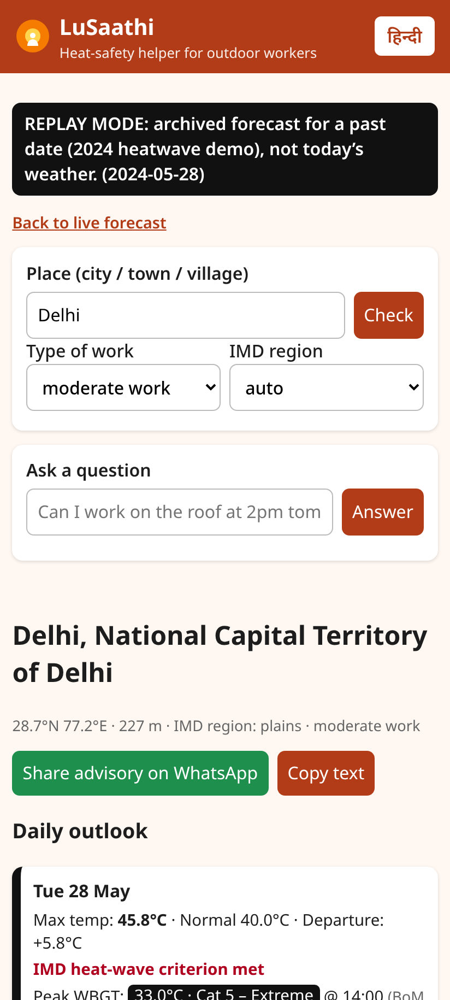
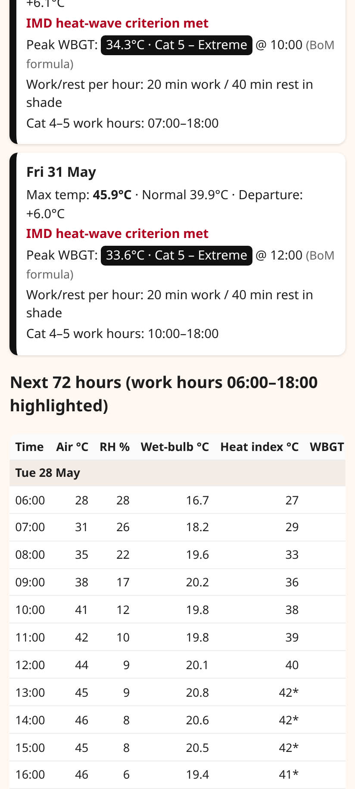
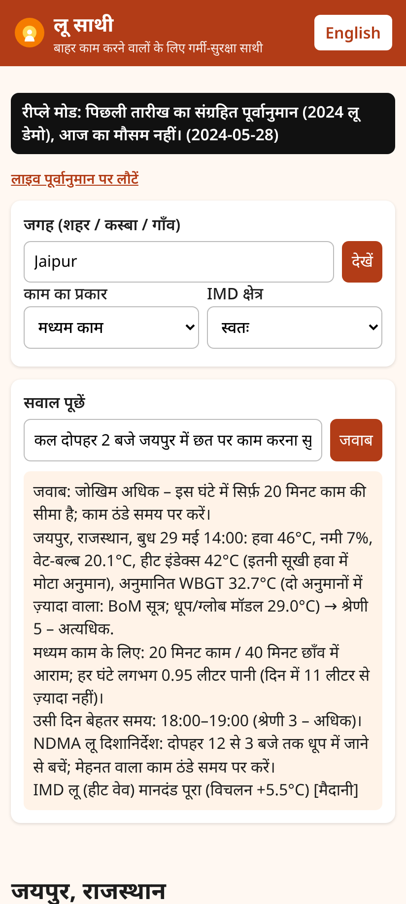

# LuSaathi (लू साथी) — heat-safety agent for India's outdoor workers

**Live app:** https://talibot-agent.github.io/lusaathi/  ·  **2024 heat-wave replay demo:** https://talibot-agent.github.io/lusaathi/?place=Delhi&replay=2024-05-28
· **Backtest:** [VALIDATION.md](VALIDATION.md) · **Methods & sources:** [docs/METHODS.md](docs/METHODS.md) · Licence: MIT

Entry for **Code for a Billion 2026** (Code for India), Climate track — requirements: [docs/CFAB_CHECKLIST.md](docs/CFAB_CHECKLIST.md).

LuSaathi turns a free weather forecast into **hour-by-hour work/rest and water schedules** for construction
workers, street vendors, farm labourers and gig riders — and into a **WhatsApp advisory** that a site supervisor,
contractor, ASHA worker or panchayat can forward in one tap. English and हिन्दी. Runs entirely in the browser
(static site, ~30 kB gzipped, no login, no API key, no server).

> "Can I work on the roof at 2pm tomorrow in Nagpur?" · "कल दोपहर जयपुर में काम करना सुरक्षित है?"

## The problem (sourced)

| Fact | Source |
|---|---|
| Up to **75 % of India's workforce — about 380 million people — depend on heat-exposed labour**; heat-exposed work contributes nearly half of GDP | World Bank (2022), *Climate Investment Opportunities in India's Cooling Sector*, https://documents1.worldbank.org/curated/en/099920011222212474/pdf/P15743300f4cc10380b9f6051f8e7ed1147.pdf |
| India is projected to lose **5.8 % of working hours in 2030 to heat stress — the equivalent of 34 million full-time jobs** (4.3 % already lost in 1995) | ILO (2019), *Working on a Warmer Planet*, https://www.ilo.org/sites/default/files/wcmsp5/groups/public/@dgreports/@dcomm/@publ/documents/publication/wcms_711919.pdf |
| **181 billion potential labour hours** lost to heat in India in 2023 (+50 % vs 1990s); **US$141 billion** potential income loss, agriculture worst hit (US$71.9 bn) | Lancet Countdown 2024, India data sheet, https://lancetcountdown.org/wp-content/uploads/2024/10/Lancet-Countdown-2024_INDIA.pdf |
| 2024 season: **110 confirmed heat-stroke deaths and 40,272 heat-stroke cases** (Union Health Ministry data, 1 Mar – ~19 Jun 2024); UP 36, Bihar 17, Rajasthan 16 deaths | Indian Express, 20 Jun 2024, https://indianexpress.com/article/india/heatwave-deaths-heatstroke-cases-union-health-ministry-9404094/ |
| Official 2024 death counts differed widely between agencies (reported as 143, 209 or 448) — i.e. heat deaths are under-recorded | Economic Times, Jun 2024, https://economictimes.indiatimes.com/news/india/summer-of-deaths-143-209-or-448-whats-the-real-death-toll-in-india-due-to-heatwave/articleshow/111181962.cms |

IMD warns about *heat waves* (air temperature), but what injures a worker is **heat stress** — temperature +
humidity + sun + wind + workload. A 38 °C humid day in Kolkata can be more dangerous for a mason than a dry 44 °C day in
Jodhpur. Workers and small contractors rarely have a WBGT meter or know a work/rest rule; NDMA's guidance
("schedule strenuous jobs to cooler times", "increase rest breaks") does not say *which* hours or *how long*.
LuSaathi fills exactly that gap.

## What it does

1. **Any Indian place** — city, town or village, typed in English or Devanagari (Open-Meteo geocoder, `countryCode=IN`).
2. **72-hour hourly heat stress** — wet-bulb (Stull), heat index (NWS) and two **WBGT** estimates: a sun/globe model
   (Dimiceli–Piltz black-globe + Stull wet-bulb, OSHA outdoor weighting) and the BoM approximation. **Cautious rule:**
   the app always uses the higher of the two, and shows which one it used (G / B).
3. **Risk bands and work/rest** — TB MED 507 heat categories 1–5 → minutes of work/rest per hour and litres of
   water per hour for light / moderate / heavy work; NDMA noon-hour (12–3 pm) guidance on heat-wave days.
4. **IMD heat-wave criteria** — plains / coastal / hills thresholds and departure from an ERA5 1991–2020 normal
   (auto-classified region, user can override).
5. **Ask in your language** — a deterministic, rule-based agent extracts *place, day, hour and type of work* from
   English, Hindi or Hinglish questions and answers with the forecast numbers in the same language. No paid LLM; nothing
   leaves the phone except the weather API calls.
6. **WhatsApp advisory** — a 3-day advisory (peak WBGT, hours needing breaks, work/rest at the hottest hour, water,
   IMD status, 108/112 reminder) shared via `wa.me`.
7. **Low-bandwidth / offline shell** — service worker caches the app; the last forecast is kept in `localStorage`.

## Evidence so far (backtest — not field data)

Re-running LuSaathi's logic on **archived day-ahead forecasts for 25 cities, Apr–Jun 2024** (the season above) against
ERA5 reanalysis — full tables, caveats and code in [VALIDATION.md](VALIDATION.md):

* **Day-ahead heat-wave alerts** (Open-Meteo best_match, the model mix the app uses): caught **120 of 125** ERA5
  heat-wave city-days — recall **0.96**, precision 0.45, F1 0.61. ECMWF IFS alone: precision 0.57, recall 0.75, F1 0.65.
* **Day-ahead dangerous-hour flag (Cat 4–5), cautious rule:** 18,685 city work-hours flagged; P 0.96 / R 0.91 / F1 0.94
  against a reference computed the same way. Against the old (permissive, sun/globe-only) definition of a dangerous
  hour it catches **5,244 of 5,249** (recall 1.00) but precision falls to **0.28** — we accept more false alarms to avoid
  missing a dangerous hour. The old permissive flag scored P = R = 0.73.
* **ERA5 reference:** under the cautious rule **19,767 of 29,575 city work-hours (66.8 %)** were at WBGT Category 4–5
  and 17,151 (58.0 %) at Category 5 (permissive baseline: 5,249 / 17.7 % and 2,191).
* **Day+1 Tmax MAE:** 1.23 °C (best_match), 1.12 °C (ECMWF IFS).
* Old vs new, side by side: [docs/METHODS.md §3b](docs/METHODS.md#3b-why-the-cautious-rule--and-what-it-costs-permissive-baseline-kept-for-comparison).

These are retrospective model-vs-reanalysis numbers. **No field deployment, user or health-outcome data exists yet.**

### The 2024 Jaipur replay at 46 °C: Category 5

On 29 May 2024 at 14:00 the archived forecast for Jaipur was 45.9 °C with only 7 % humidity, so the Stull (2011)
wet-bulb is just 20.1 °C and the sun/globe WBGT model gives 0.7·20.1 + 0.2·51.7 + 0.1·45.9 = 29.0 °C (Category 2).
The BoM approximation gives **32.7 °C**. Under the cautious rule the app uses the higher value, so the answer is
**"High risk": Category 5, 20 min work / 40 min rest for moderate work**, and it says the BoM formula drove it. The NWS
heat index (41.7 °C) is outside the range that formula is defined for at this humidity; the app marks it `*` and does
not use it. Full table: [docs/METHODS.md §3a](docs/METHODS.md#3a-worked-example-the-2024-jaipur-replay-at-46-c--now-category-5).

## Screenshots

Phone-width captures of the live app (replay mode, archived forecasts for the May 2024 heat wave):

| Delhi, 28 May 2024 | Daily outlook + hourly table | Hindi question, Jaipur |
|---|---|---|
|  |  |  |

## How to use it (60 seconds)

1. Open https://talibot-agent.github.io/lusaathi/ on any phone and type a place (English or हिन्दी).
2. Pick the type of work (light / moderate / heavy). Read the **Daily outlook**: IMD heat-wave status, peak WBGT and the
   work/rest rule at the hottest hour; the **Next 72 hours** table shows every hour (air, humidity, wet-bulb, heat index, WBGT with G/B source).
3. Or ask a question — "Can I work on the roof at 2pm tomorrow in Nagpur?" / "कल दोपहर जयपुर में काम करना सुरक्षित है?".
4. Tap **Share advisory on WhatsApp** to send the 3-day advisory to a crew, a contractor group or an ASHA worker.

## Architecture

```
Browser (static, GitHub Pages)
 ├─ app.js            UI, language toggle, share, service worker
 ├─ lib/intent.js     rule-based EN/HI/Hinglish parser  (+ lib/gazetteer.js)
 ├─ lib/model.js      Open-Meteo URLs, hourly → daily assessment
 ├─ lib/heat.js       heat index, WBGT (Dimiceli–Piltz + Stull), TB MED 507 work/rest, NIOSH REL
 ├─ lib/imd.js        IMD criteria, region classification (lib/coast.js = Natural Earth coastline)
 └─ lib/advisor.js    answers + WhatsApp advisory text (lib/i18n.js strings)
        │  fetch (CORS, no key)
        ▼
 Open-Meteo: geocoding · forecast · ERA5 archive (normals) · historical-forecast (replay)

python/lusaathi_core/  same math in Python (tests/js/crosscheck.test.mjs asserts JS == Python)
validation/backtest.py reproducible 2024 backtest → validation/results.json → VALIDATION.md
```

## Setup

No build step.

```bash
git clone https://github.com/talibot-agent/lusaathi && cd lusaathi
python3 -m http.server 8000          # open http://localhost:8000  (ES modules need http://, not file://)

# tests
pip install pytest && python3 -m pytest -q tests      # Python: heat math + IMD classifier
npm test                                              # Node ≥18: intent parser, heat/IMD, advisor, JS↔Python cross-check

# reproduce the backtest (network, ~110 free Open-Meteo calls)
python3 validation/backtest.py && python3 validation/make_report.py
```

Deployment: `.github/workflows/pages.yml` runs both test suites and publishes the static files to GitHub Pages on every push to `main`.

URL parameters: `?place=Jaipur`, `&lang=hi`, `&w=easy|moderate|hard`, `&replay=YYYY-MM-DD` (archived forecast demo).

## Methods

See [docs/METHODS.md](docs/METHODS.md) for every formula, threshold and its source (NWS, OSHA, Dimiceli & Piltz,
Stull 2011, BoM, TB MED 507, NIOSH 2016, IMD, NDMA 2017, FAO-56, NOAA).

## Limitations

* Forecast-model estimates for a ~10–25 km grid cell — not on-site measurements; roofs, kilns, asphalt and shade change exposure.
* WBGT is modelled two ways and the app uses the higher (cautious) estimate — in practice the BoM formula, which ignores the actual sun and wind, so it can overstate heat stress in shade, at dawn and at dusk; expect more restricted hours than a WBGT meter would show.
* IMD criteria are applied at a single point; region type is auto-classified (elevation / distance to coast) and can be overridden.
* Work/rest comes from TB MED 507 (acclimatised adults); new, older, pregnant or unwell workers need more protection.
* Day-ahead heat-wave alerts trade precision for recall (see VALIDATION.md); coastal Chennai shows a warm forecast bias.
* No field validation yet. Official IMD / NDMA / State Heat Action Plan alerts always take priority.

## Team, credits & AI authorship

Mykel Nelson ([@talibot-agent](https://github.com/talibot-agent)), solo.

**AI authorship disclosure:** the code, docs, backtest, screenshots and submission text were written by an AI coding
agent working under the author's direction; the author reviewed them. All numbers come from the scripts in this repo or
the cited sources — none were typed in by hand. The app itself uses no LLM at run time: its question-answering agent is
deterministic and rule-based.

Weather data: [Open-Meteo](https://open-meteo.com/) (CC BY 4.0), incl. ECMWF, NOAA GFS, DWD ICON and Copernicus ERA5.
Coastline: Natural Earth (public domain).

## License

MIT — see [LICENSE](LICENSE).
